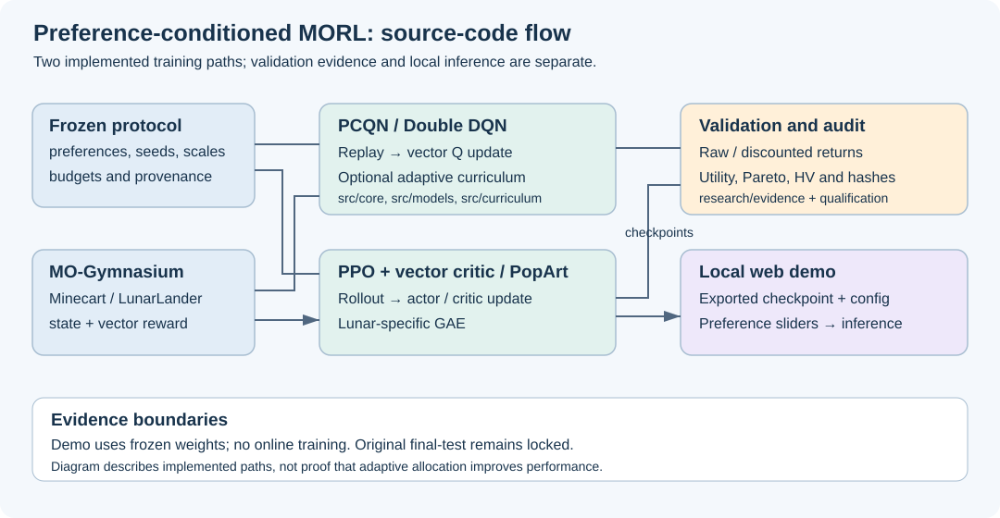

# Adaptive Preference-Conditioned Multi-Objective Reinforcement Learning

[](https://github.com/SpeedyLabX)
[](LICENSE)
[](pyproject.toml)

A reproducible multi-objective reinforcement learning (MORL) research repository from
**[SpeedyLabX](https://github.com/SpeedyLabX)** studying preference-conditioned policies on
**Minecart** (`minecart-v0`) and **MO-LunarLander** (`mo-lunar-lander-v3`). Policies receive
both an environment observation and a preference vector `w`, enabling a single network to
represent trade-offs across competing objectives.

The repository provides PCQN and PPO implementations, frozen experiment protocols,
deterministic evaluation and validation-audit pipelines, versioned negative and positive
empirical evidence, an interactive inference demo, a native terminal training monitor, and
a Git-native research harness.

## Research Scope & Scientific Boundaries

The original research question investigates adaptive preference allocation toward hard,
uncertain, or learnable preference regions. We explicitly maintain the following scientific
boundaries:

- **Adaptive-allocation advantage is not established.** Historical PCQN and Minecart
  remediation studies failed their predeclared qualification gates and are retained in full
  as informative negative results.
- **On-policy PPO confirmation is bounded.** Prospective multi-seed PPO runs pass their
  predeclared nominal task gates on both environments, but do not establish universal
  arbitrary-preference competence, dynamics robustness, or adaptive-allocation superiority.
- **Final-test firewall remains intact.** Phase 4 is active; final-test splits are never
  used for tuning, normalization, reference-point calibration, or checkpoint selection.
- **Raw provenance is preserved.** Reported results retain raw and discounted vector
  returns, protocol/checkpoint SHA-256 hashes, seeds, and separated training/evaluation
  budgets.

## Recorded Empirical Evidence

All entries below are existing development/validation records (no final-test access):

| Study | Scope & Budget | Recorded Outcome | Evidence |
|---|---|---|---|
| **Minecart PPO Confirmation** | 3 fresh training seeds, 4M interactions/seed (12M total) | Every seed achieved `10/10` deliveries across both task profiles and both inference modes (`sampled` and `argmax`), with utility above idle. | [Results & limits](docs/research/ONPOLICY_CONFIRMATION_RESULTS_20261103.md), [raw JSON](research/evidence/minecart_onpolicy_confirmation_v1.json) |
| **MO-LunarLander PPO Confirmation** | 2 fresh training seeds, 4M interactions/seed (8M total) | Every seed achieved `10/10` native helipad landings at the trained preference `[0.7, 0.1, 0.1, 0.1]` in both inference modes. | [Results & limits](docs/research/LUNAR_CONFIRMATION_RESULTS_20261103.md), [raw JSON](research/evidence/lunar_onpolicy_confirmation_v1.json) |
| **PCQN & Minecart Remediation (v1, v2, F1, P2)** | Multi-seed off-policy PCQN, PER, F1 success-replay, and P2 relabel/loss studies | Predeclared task qualification gates failed; full negative evidence and root-cause diagnostics are retained. | [Project status](docs/research/PROJECT_STATUS.md), [F1 receipt](research/qualification/minecart_pcqn_replay_f1.json) |

## Architecture & Key Components



- **Environments:**
  - **Minecart:** 3D reward vector trading off two delivered ore objectives against fuel cost.
  - **MO-LunarLander:** 4D reward vector trading off landing outcome, shaping, and main/side engine costs, with constructor-level dynamics shifts.
- **Algorithms:**
  - **PCQN** (`src/models/q_network.py`, `src/models/update.py`, `src/core/replay_buffer.py`): preference-conditioned masked multi-head vector Q-network, per-head Double-DQN targets, uniform/PER/F1 trajectory replay, and curriculum signals (`gap`, `uncertainty`, `coverage_recency`, `progress`, static `geometry`).
  - **On-Policy PPO** (`src/models/onpolicy.py`, `src/models/lunar_onpolicy.py`): categorical PPO with vector critic and PopArt normalization, plus a separate GAE-based Lunar implementation with exact Box2D replay reconstruction.
- **Evaluation & Auditing:** Exact deterministic hypervolume (`pymoo` for ≥3D, native 2D), expected utility, scalarized regret, IGD, sparsity, per-objective Spearman controllability, and fail-closed validation auditors (`src/evaluation/`).
- **Research Harness:** Evidence-gated Phase 0–7 roadmap, claim/experiment/literature registries, and automated state validation (`scripts/research_harness.py`, `src/research_harness/`).
- **Interactive Demo & Monitor:** Two-panel frozen-policy inference UI (`demo/interactive/`) and a read-only native Rich terminal monitor (`monitor/terminal.py`).

Implementation contracts: [PCQN architecture](docs/ARCHITECTURE.md) · [Minecart PPO](docs/research/ONPOLICY_IMPLEMENTATION_V1.md) · [Lunar PPO](docs/research/LUNAR_PPO_SPECIALIST_V1.md) · [Roadmap](docs/research/ROADMAP.md).

## Repository Layout

```text
src/          Core library: models, replay, curriculum, envs, evaluation, demo, research_harness
scripts/      Training, evaluation, calibration, qualification, audit, and report-build CLIs
configs/      Algorithm configs, frozen protocols, dynamics shifts, and experiment plans
tests/        Unit, invariant, recovery, demo, and provenance test suite
research/     Claims, experiment registry, literature metadata, evidence, and qualification receipts
docs/         Architecture contracts, research reports, reproducibility guide, and diagrams
paper/        Editable LaTeX manuscript source and generated data figures
demo/         Local two-panel interactive inference frontend (HTML/CSS/JS Canvas)
monitor/      Native Rich terminal monitor and optional local web viewer
```

Generated checkpoints (`artifacts/`), delivery packages (`outputs/`), raw logs, and local
knowledge graphs (`graphify-out/`) are excluded from Git.

## Setup & Installation

Use a dedicated **Python 3.11** virtual environment on Linux or WSL Ubuntu:

```bash
git clone https://github.com/SpeedyLabX/adaptive-preference-morl.git
cd adaptive-preference-morl

# System headers required for Box2D and pycddlib (GPI-LS)
sudo apt-get install build-essential swig libcdd-dev

python3.11 -m venv .venv
source .venv/bin/activate
python -m pip install --upgrade pip
python -m pip install -r requirements.txt

# Verify repository research state
python scripts/research_harness.py doctor
python scripts/research_harness.py status
python scripts/research_harness.py roadmap list
```

See [docs/REPRODUCIBILITY.md](docs/REPRODUCIBILITY.md) for platform caveats and exact
reproduction boundaries.

## Verification & Quality Gates

From the repository root with the project environment activated:

```bash
python -m ruff format --check .
python -m ruff check .
python -m mypy src scripts
python -m pytest -q
python -m bandit -q -r src scripts -ll
python -m compileall -q src scripts tests
git diff --check
```

## Optional Engineering Smoke Run

This produces a local **engineering smoke artifact** (`artifacts/local-smoke/`), not
reportable research evidence:

```bash
python scripts/train.py   --env mo-lunar-lander-v3   --protocol configs/protocols/course_mo_lunar_lander_v3.json   --algo uniform-pcqn   --seed 42   --total-timesteps 10000   --learning-starts 1000   --output-dir artifacts/local-smoke

python scripts/evaluate.py   --model-path artifacts/local-smoke/uniform-pcqn_mo-lunar-lander-v3_seed42/final.pt   --protocol configs/protocols/course_mo_lunar_lander_v3.json   --split validation   --episodes-per-preference 1   --shift nominal   --output results/local-smoke_validation.json
```

## Interactive Inference Demo & Report Build

- **Interactive Demo:** Pretrained checkpoints are not committed to Git. With exported
  audited policy weights available locally, launch the read-only inference server via
  `demo/interactive/launch.py --port 8765` and open `http://127.0.0.1:8765`. See
  [demo/interactive/README_EN.md](demo/interactive/README_EN.md).
- **LaTeX Report:** Editable manuscript source lives in [paper/REL301m/main.tex](paper/REL301m/main.tex);
  build instructions are in [paper/REL301m/BUILD_ENGLISH.md](paper/REL301m/BUILD_ENGLISH.md).

## Contributors & Acknowledgments

Developed as a research project under **[SpeedyLabX](https://github.com/SpeedyLabX)** (FPT University):

- **Huynh Quoc Viet** ([@Am2uocVi3t](https://github.com/Am2uocVi3t)) — Team Lead, Research & Algorithm Design
- **Le Nguyen Gia Hung** ([@hei1sme](https://github.com/hei1sme)) — Architecture, Interactive Demo & Systems
- **Ngo Hoai Nam** ([@justHman](https://github.com/justHman)) — Experiments & Critical Analysis
- **Luu Giang Nam** — Research Advisor (FPT University)

## Citation

If you build on this codebase, frozen protocols, or empirical evidence, please cite it using
[CITATION.cff](CITATION.cff) or the BibTeX entry below:

```bibtex
@software{speedylabx2026adaptive_morl,
  author       = {Huynh, Quoc Viet and Le, Nguyen Gia Hung and Ngo, Hoai Nam},
  title        = {Adaptive Preference-Conditioned Multi-Objective Reinforcement Learning},
  year         = {2026},
  publisher    = {SpeedyLabX},
  url          = {https://github.com/SpeedyLabX/adaptive-preference-morl}
}
```

## License

Released under the [MIT License](LICENSE).
